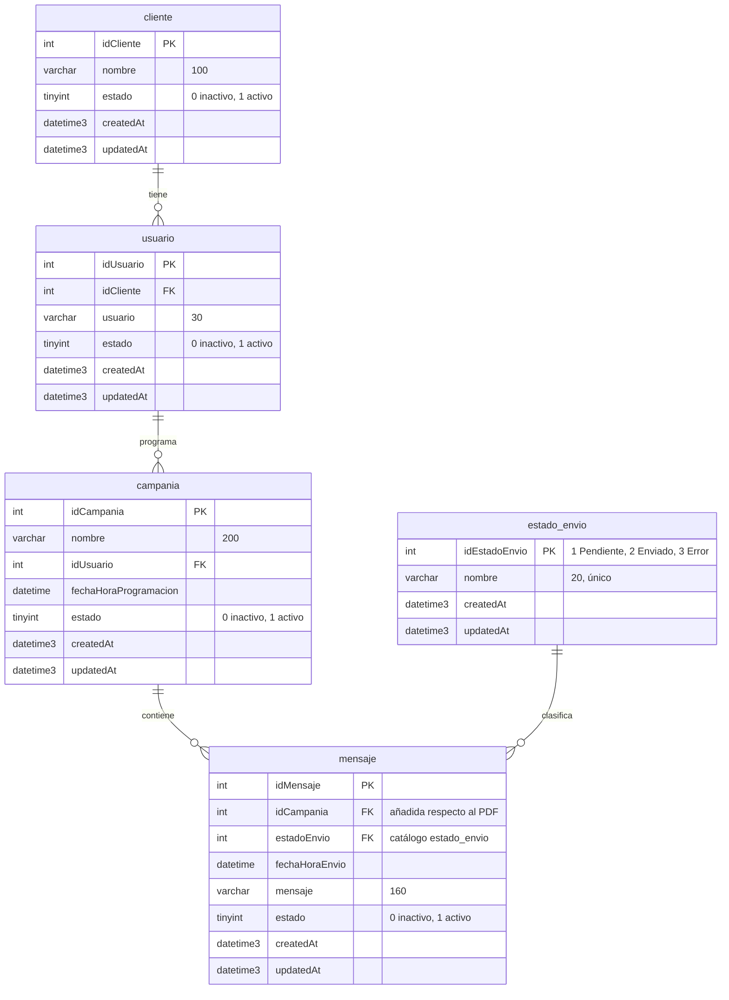

# Modelo de datos (ER)

Modelo del enunciado + las decisiones de diseño explicadas al final de este documento. El DDL ejecutable está en
[`schema.sql`](schema.sql) y es idéntico al que producen las migraciones Knex.

## Convenciones

- **Integridad:** todas las FK son `ON UPDATE CASCADE ON DELETE RESTRICT`.
- **`estado`:** `TINYINT` 0/1 (inactivo/activo), con `CHECK`.
- **Auditoría:** `createdAt` / `updatedAt` mantenidos por MySQL (`DATETIME(3)`, UTC).
- **Índice del reporte:** `idx_mensaje_estado_fecha (estado, fechaHoraEnvio)`.
- **Catálogo:** `estado_envio` son datos de referencia; los crea la migración, no el seed.
- **Fechas:** todas en UTC. El driver usa `timezone: 'Z'` y cada conexión ejecuta
  `SET time_zone = '+00:00'` (los `DEFAULT CURRENT_TIMESTAMP` usan la zona de la sesión).

## Decisiones de diseño respecto al enunciado

1. **`mensaje.idCampania` (FK añadida).** El PDF no lista esta columna en `mensaje`,
   pero su diagrama dibuja la relación `campania -> mensaje`. Sin ella no hay forma de
   saber a qué campaña (y por lo tanto a qué cliente) pertenece cada mensaje, y sería
   imposible el filtro opcional por cliente del reporte (join
   `mensaje -> campania -> usuario -> cliente`).
2. **Catálogo `estado_envio` (3FN).** `mensaje.estadoEnvio` sigue siendo `INT` como en el
   enunciado, pero es FK a `estado_envio(idEstadoEnvio, nombre)`: el significado de
   1/2/3 vive en datos con integridad referencial, no en un código "mágico". El enum
   `EstadoEnvio` del dominio debe coincidir con el catálogo; un test lo verifica.
3. **Trazabilidad.** `createdAt` / `updatedAt` en todas las tablas, mantenidos por MySQL
   (no por la aplicación) y fuera del dominio y de la API.
4. **Filtro de mes.** El reporte filtra por `mensaje.fechaHoraEnvio` dentro del mes
   pedido (rango semi-abierto `[inicio, fin)` en UTC) y solo cuenta mensajes activos
   (`mensaje.estado = 1`).
